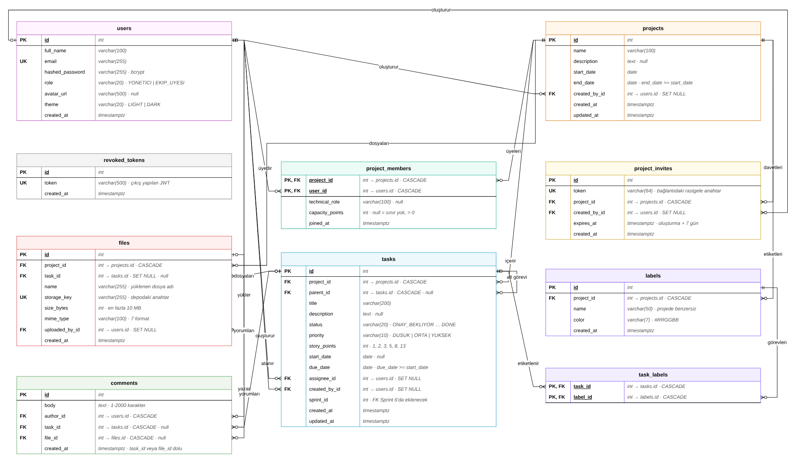

# LUNO · ER Diyagramı (Sprint 5)

Şu an veritabanında bulunan tablolar: `users`, `revoked_tokens`, `projects`, `project_members`, `project_invites`, `tasks`, `labels`, `task_labels`, `comments`, `files`.
Kaynak: API Sözleşmesi v1.1, bölüm 2 (Veri nesneleri). Model kodu: `backend/app/models/`.

Düzenlenebilir kaynak: [`er-diyagrami.drawio`](er-diyagrami.drawio) (draw.io / diagrams.net ile açılır). Değişiklik yapınca PNG'yi *File → Export as → PNG* ile yeniden dışa aktarın.

## Tablolar

| Tablo | Model | Açıklama |
|---|---|---|
| `users` | `app/models/user.py` (Esra, US-001 – US-004) | Kullanıcılar ve sistem rolleri |
| `revoked_tokens` | `app/models/user.py` (Esra, US-003) | Çıkış yapılmış JWT'ler |
| `projects` | `app/models/project.py` | Projeler |
| `project_members` | `app/models/project_member.py` | Proje üyelikleri, teknik rol ve kapasite |
| `project_invites` | `app/models/project_invite.py` (Esra, US-010) | Projeye davet bağlantıları (migration `0002`) |
| `tasks` | `app/models/task.py` | Görevler ve alt görevler |
| `labels` | `app/models/label.py` (US-033) | Proje bazında etiketler (migration `0003`) |
| `task_labels` | `app/models/label.py` (US-033) | Görev ↔ etiket bağlantısı (çoka çok) |
| `comments` | `app/models/comment.py` (Esra, US-020) | Görev ve dosya yorumları (migration `0004`) |
| `files` | `app/models/file.py` (US-018, US-019, US-035) | Proje ve görev dosyaları; içerik depoda, burada bilgileri (migration `0005`) |

## Kurallar

| Kural | Nerede | Kaynak |
|---|---|---|
| E-posta benzersiz | `users.email` unique index | FR-003 |
| Yeni kullanıcı `EKIP_UYESI` | `users.role` varsayılan değer | FR-010 |
| Şifreler düz metin değil, bcrypt hash olarak saklanır | `users.hashed_password` | NFR-001 |
| Bir kişi bir projeye bir kez üye olur | `project_members` birleşik PK | — |
| Aynı projede aynı adla iki etiket olamaz | `labels` (project_id, name) unique; API büyük/küçük harfi de eşit sayar | FR-037, sözleşme 6.11 |
| Yorum ya bir göreve ya bir dosyaya aittir | `comments` check kısıtı (`task_id` veya `file_id` dolu) | FR-050 |
| Dosya en fazla 10 MB; PDF, DOCX, XLSX, PPTX, PNG, JPG, TXT; uzantı ve içerik birlikte kontrol edilir | API (`app/services/file_validation.py`) | FR-046, FR-047, NFR-006 |
| Her dosyanın depoda benzersiz bir anahtarı vardır | `files.storage_key` unique | — |
| Davet bağlantısı benzersiz ve 7 gün geçerli | `project_invites.token` unique index, `expires_at` | FR-021, sözleşme 5.8 |
| Proje bitişi başlangıçtan önce olamaz | `projects` check kısıtı | FR-016 |
| Teslim tarihi başlangıçtan önce olamaz | `tasks` check kısıtı | FR-025 |
| Görev durumu ve önceliği yalnızca tanımlı değerler | `tasks` check kısıtları | Sözleşme 1.3 |
| Efor puanı 1, 2, 3, 5, 8, 13 | `tasks` check kısıtı | FR-036 |
| Kapasite boşsa sınır yok, doluysa > 0 | `project_members` check kısıtı | FR-074, FR-075 |
| Proje silinince görevleri, üyelikleri, davetleri, etiketleri ve dosya kayıtları silinir | `ON DELETE CASCADE` + ORM cascade | FR-020 |
| Görev veya etiket silinince aradaki bağlantı silinir (görev ve etiketin kendisi kalır) | `task_labels` iki yönde `ON DELETE CASCADE` | FR-037 |
| Dosya silinince yorumları silinir | `comments.file_id ON DELETE CASCADE` | Sözleşme 8.4 |
| Görev silinince yorumları silinir, dosyaları projede kalır | `comments.task_id CASCADE`, `files.task_id SET NULL` | — |
| Ana görev silinince alt görevleri silinir | `tasks.parent_id ON DELETE CASCADE` + ORM cascade | Sözleşme 6.7 |
| Atanan kişi silinince görev atamasız kalır | `tasks.assignee_id ON DELETE SET NULL` | Sözleşme 5.10 |
| Şema değişiklikleri yalnızca Alembic migration ile yapılır | `backend/alembic/versions/` | NFR-018 |
| 200 görev / 20 üyeli projeyle test edilebilir | `python -m app.seed --buyuk` | NFR-011 |

Durum ve öncelik, `users.role` ile aynı şekilde metin (`varchar`) olarak saklanır ve CHECK kısıtıyla korunur. Böylece SQLite (testler, varsayılan `.env`) ve PostgreSQL'de aynı şekilde çalışır; ileride yeni değer eklemek de tek bir migration ile yapılır.

## Tabloda tutulmayan, API'de hesaplanan alanlar

- `Project.progress_percent` (FR-061), `Project.member_count`
- `Task.risk_level` (FR-070 – FR-072), `subtask_count`, `subtask_done_count`, `comment_count`, `file_count`
- `ProjectMember.email`, `ProjectMember.system_role` (`users` tablosundan gelir)
- `File.comment_count` (dosyanın yorum sayısı)

## API katmanında kontrol edilecek kurallar

- Alt görevin alt görevi olamaz (6.10, `NESTED_SUBTASK_NOT_ALLOWED`). `app/services/tasks.py` içinde uygulanıyor.
- Atanan kişi projenin üyesi olmalı (6.2, `ASSIGNEE_NOT_MEMBER`).
- Üye projeden çıkarılınca o projedeki görevlerinin `assignee_id`'si `null` yapılır (5.10).
- Alt görevin `project_id`'si ana görevinkiyle aynı olmalı (veritabanı bunu engellemez; alt görev uç noktası projeyi ana görevden alır).
- Göreve eklenen etiketler aynı projeye ait olmalı (`label_ids`, 422 `VALIDATION_ERROR`).
- Dosyayı yalnızca yükleyen kişi veya Yönetici silebilir (8.4, `FORBIDDEN`); dosya depodan da silinir.
- Göreve dosya yüklenirken görev aynı projeye ait olmalı (`TASK_NOT_FOUND`).
- Daveti kabul ederken süresi dolmuş bağlantı reddedilir (`expires_at`, 5.9 `INVITE_INVALID`); zaten üye olan kullanıcı `ALREADY_MEMBER` alır.

## Sonraki sprintlerde eklenecek tablolar

| Tablo | Sprint | Not |
|---|---|---|
| `notifications` | 6 | Bildirimler (FR-051) |
| `sprints` | 6 | `tasks.sprint_id` için FK bu tabloyla eklenir |
| `notification_preferences`, `password_reset_tokens` | 8 | Bildirim tercihleri, şifre sıfırlama |
| `task_dependencies` | 9 | Görev bağımlılıkları (FR-040) |
