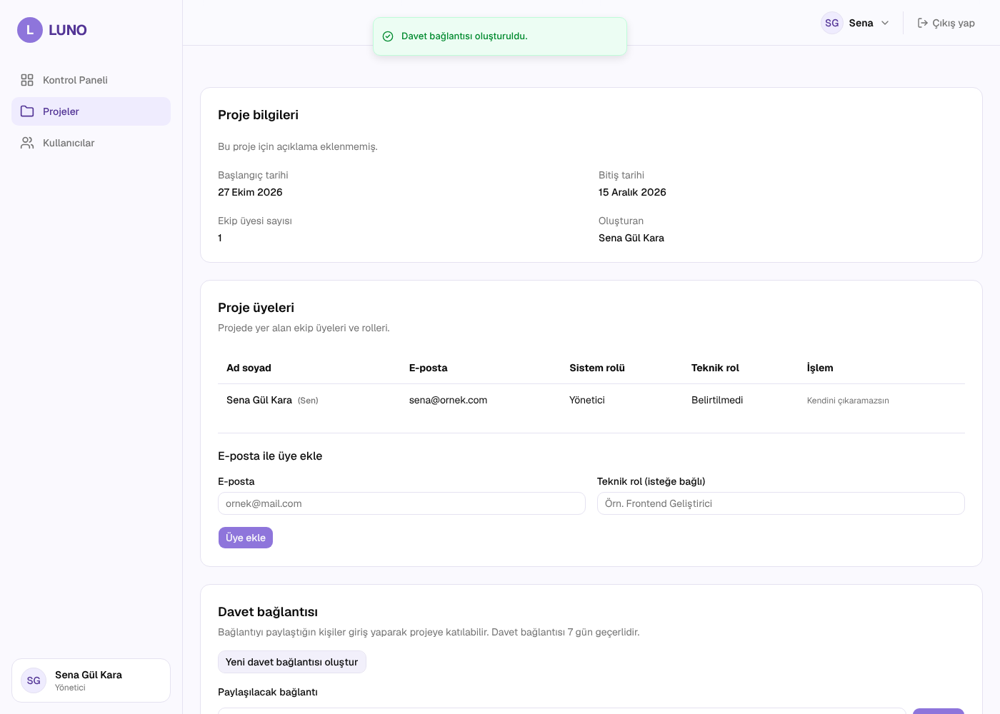
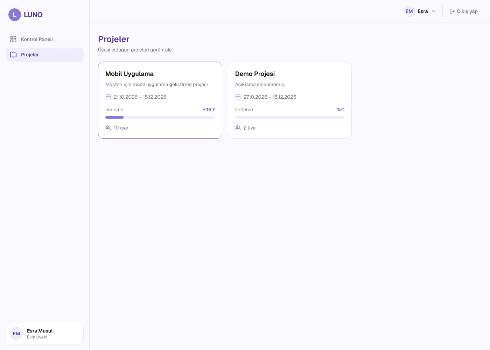

# Sprint 3 · Uçtan uca demo kontrolü

**Görev:** #128 · **Sorumlu:** Sena Gül Kara
**Tarih:** 26 Ekim 2026 · **Sürüm:** `develop` @ `b0b574f` (#187 birleşimi sonrası)
**Kapsam:** US-005 – US-010 (yetkiler, proje oluşturma, listeleme, düzenleme, silme, üye yönetimi)

## Yöntem

- Backend ve frontend yerelde çalıştırıldı, veriler `python -m app.seed --reset` ile sıfırlandı (şifre: `Luno1234`).
- **API:** README'deki "Sprint 3 demo senaryosu" tablosunun 12 adımı gerçek istek olarak çalıştırıldı.
- **Arayüz:** Görevdeki adımlar otomatik tarayıcı testiyle (Playwright, Chromium) arayüzden denendi; sonuçlar API'den tekrar okunarak doğrulandı.
- Ön kontroller: backend testleri 379 passed, `npm run lint` temiz (mevcut 3 Fast Refresh uyarısı), `npm run build` başarılı.

## API senaryosu (README tablosu)

| # | Kim | Adım | Sonuç | Durum |
|---|---|---|---|---|
| 1 | Esra | Proje oluşturma | 403 `FORBIDDEN` | ✓ |
| 2 | Sena | "Sprint 3 Demo" projesini oluşturma | 201, oluşturan otomatik üye | ✓ |
| 3 | Sena | Bitiş tarihi başlangıçtan önce | 400 `INVALID_DATE_RANGE` | ✓ |
| 4 | Sena, Esra, Can | Proje listesi | Herkes yalnızca üyesi olduğu projeleri görüyor; Can'ın listesi boş | ✓ |
| 5 | Esra | Üyesi olmadığı proje 2 | 403 `PROJECT_ACCESS_DENIED` | ✓ |
| 6 | Sena | Proje adını düzenleme | 200 | ✓ |
| 7 | Sena | Can'ı e-postayla ekleme / tekrar / kayıtsız e-posta | 201 / 409 `ALREADY_MEMBER` / 404 `USER_NOT_FOUND` | ✓ |
| 8 | Aybüke | Davet bağlantısı oluşturma | 201, 7 gün geçerli | ✓ |
| 9 | Esra | Geçerli daveti kabul / tekrar | 200 / 409 `ALREADY_MEMBER` | ✓ |
| 10 | Can | Süresi dolmuş davet | 400 `INVITE_INVALID` | ✓ |
| 11 | Aybüke | Esra'yı çıkarma / Esra'nın tekrar erişimi / kendini çıkarma | 204 / 403 / 400 `CANNOT_REMOVE_SELF` | ✓ |
| 12 | Sena | Projeyi silme ve tekrar okuma | 204 / 404 `PROJECT_NOT_FOUND` | ✓ |

## Arayüz senaryosu (görev maddeleri)

| # | Adım | Sonuç | Durum |
|---|---|---|---|
| 1 | Yönetici (Sena) "Yeni proje" ile proje oluşturur | Proje oluştu, listede görünüyor | ✓ |
| 2 | Yönetici proje detayında davet bağlantısı oluşturur | `/davet/...` bağlantısı üretildi | ✓ |
| 3 | Ekip üyesi (Esra) bağlantıyı açıp daveti kabul eder | Esra projeye katıldı | ✓ |
| 4 | Ekip üyesi yalnızca kendi projelerini görür | Esra: Mobil Uygulama ve Demo Projesi; Kurumsal Web Sitesi görünmüyor | ✓ |
| 5 | Ekip üyesinde silme engellenir | "Projeyi sil" ve "Projeyi düzenle" butonları görünmüyor; doğrudan API isteği 403 | ✓ |
| 6 | Üye olmayan kullanıcı (Can) proje adresini açar | "Bu projeye erişimin yok" ekranı | ✓ |
| 7 | Ekip üyesi `/kullanicilar` adresini açar | Erişim engelleniyor ancak uyarı gösterilmeden ana sayfaya yönlendiriliyor | ✗ (bilinen hata #145) |

Tarayıcı konsolunda hata görülmedi.

## Kanıtlar

## Canlı ortam kontrolü

Bu oturumdan Render adreslerine erişilemediği için canlı ortam elle denenecek. Kontrol listesi:

- [ ] `https://luno-api-mu54.onrender.com/health` → `{"status":"ok"}`
- [ ] `https://luno-frontend.onrender.com` açılıyor, kayıt ve giriş çalışıyor
- [ ] Yönetici hesabıyla proje oluşturma ve davet bağlantısı üretme
- [ ] Ekip üyesi hesabıyla daveti kabul etme; yalnızca kendi projelerini görme
- [ ] Ekip üyesinde "Projeyi sil" butonunun görünmemesi

Not: Canlı veritabanında seed çalıştırılmadığı için hesaplar canlı ortamda ayrıca oluşturulmalıdır.

## Sonuç

Sprint 3 hedefi ("Yönetici proje oluşturup düzenleyebilsin, üye ekleyebilsin; yetkisiz işlemler engellensin") yerel ortamda karşılanıyor. Açık kalan tek bulgu #145: yetkisiz erişim engelleniyor, ancak FR-012'nin istediği uyarı mesajı yönetici sayfasında gösterilmiyor.
