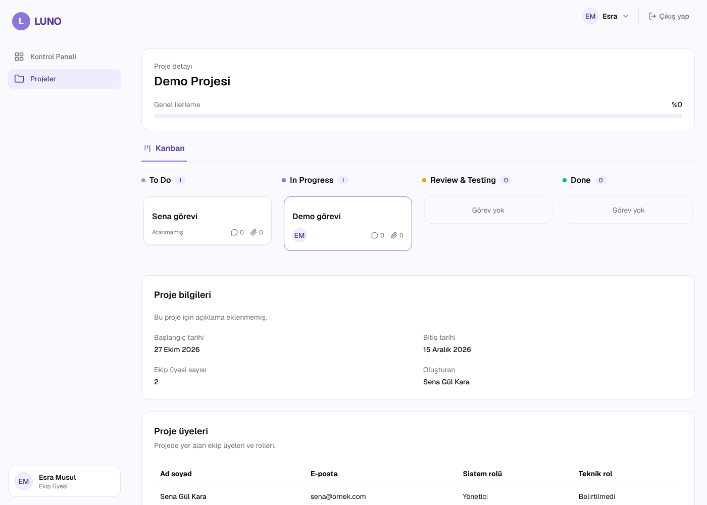
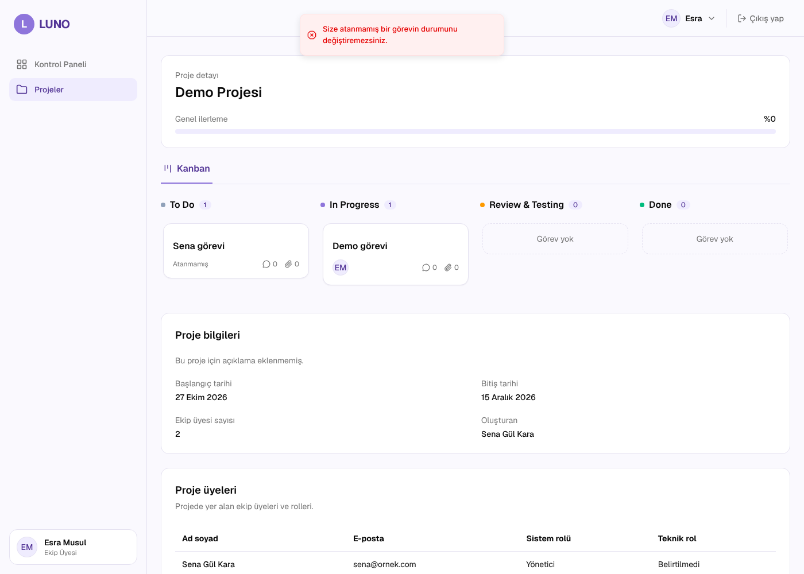

# Sprint 4 · Uçtan uca demo kontrolü

**Görev:** #171 · **Sorumlu:** Sena Gül Kara
**Tarih:** 26 Ekim 2026 · **Sürüm:** `develop` @ `b0b574f` (#187 birleşimi sonrası)
**Kapsam:** Görevler ve Kanban (US-011 – US-015)

## Yöntem

- Backend ve frontend yerelde çalıştırıldı, veriler `python -m app.seed --reset` ile sıfırlandı (şifre: `Luno1234`).
- Adımlar otomatik tarayıcı testiyle (Playwright, Chromium) arayüzden denendi; her adımın sonucu API'den tekrar okunarak doğrulandı.
- Ön kontroller: backend testleri 379 passed (US-011, US-014, US-015 kabul testleri dahil, atlanan test yok), `npm run lint` temiz, `npm run build` başarılı.

## Sonuçlar

| # | Adım | Sonuç | Durum |
|---|---|---|---|
| 1 | Yönetici (Sena) "Yeni görev" formuyla görev oluşturup Esra'ya atar | Görev To Do sütununda; API: `TODO`, sorumlu Esra Musul | ✓ |
| 2 | Ekip üyesi (Esra) kendisine atanan görevi Kanban'da In Progress'e sürükler | Kart yeni sütunda; API: `IN_PROGRESS` | ✓ |
| 3 | Ekip üyesi kendisine atanmamış bir görevi Done'a sürüklemeye çalışır | Kart eski sütununa döndü, "Size atanmamış bir görevin durumunu değiştiremezsiniz." uyarısı çıktı; API: `TODO` (değişmedi) | ✓ |

Ek gözlemler (#187 incelemesinde, aynı sürüm üzerinde):

- Ekip üyesi "Yeni görev" butonunu görmüyor.
- Görev detayından durum ve sorumlu değişikliği kalıcı olarak kaydediliyor; ekip üyesinde Düzenle/Sil butonları gizli.
- Kanban yalnızca aktif ana görevleri gösteriyor (onay bekleyen ve reddedilen görevler panoda yok).

Tarayıcı konsolunda beklenen 403 yanıtı dışında hata görülmedi.

## Kanıtlar

## Canlı ortam kontrolü

Görev yerel sonuçlarla kapatıldı. Canlı ortamda proje listeleme 500 döndüğü için (bkz. [Sprint 3 demo kontrolü](../sprint-03/demo-kontrolu.md)) Kanban akışı canlıda denenemedi. Canlı ortam düzeltildikten sonra aynı üç adım canlıda tekrarlanmalıdır.

## Sonuç

Sprint 4 hedefi ("Görevler oluşturulup atanabilsin, Kanban panosunda sürükle-bırak ile ilerletilebilsin") yerel ortamda karşılanıyor. Bulunan yeni bir hata yok.

Bilinen açık konular:

- `PATCH /tasks/{id}` isteğinde `"title": null` gönderilince 500 dönüyor (hata raporu Emre için hazırlandı). Arayüz bu isteği göndermediği için demo akışını etkilemiyor.
- Kanban'da sütun içi sıralama yok (görev sırası alanı bulunmuyor); ürün kararı olarak değerlendirilecek.
