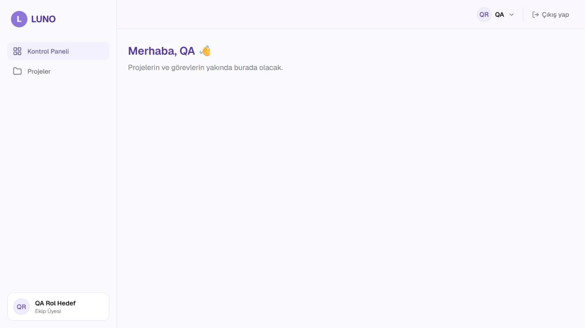
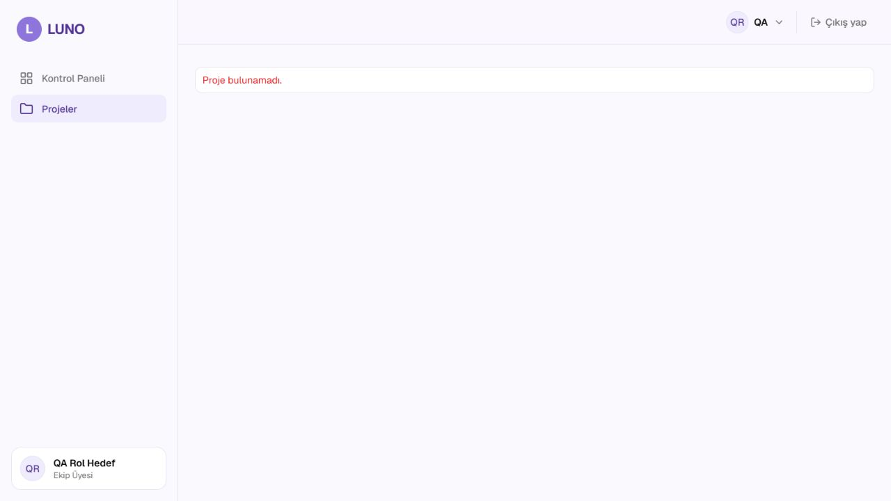

# US-005 Yetki testleri

Görev: [#99](https://github.com/sengka/LUNO/issues/99) · Story: [#15](https://github.com/sengka/LUNO/issues/15) · FR-012, FR-013.
Tarih: 19.10.2026 · QA: Hakan Aydın, Codex ile API ve tarayıcı otomasyonu.
Temel ürün sürümü: develop **9fad8ab**. Bu dal yalnız test/rapor/kanıt ekler.

## Sonuç ve sınır

**Kısmi kabul: US-005 tamamen geçti denemez.** Yeni testler: 18 geçti, eksik gerçek ürün rotalarına bağlı 7 senaryo Engelli/skip. Tam backend: **93 geçti, 7 skip, 4 deprecation uyarısı**. 75 temel test korunmuştur; önceki US-002–004 dallarının sayıları bu dala eklenmedi.

FR-012'nin çalışan rol/üye kontrolleri doğru 403 mesajı ve değişmeyen veri ile doğrulandı. FR-013 yönetici-üye ayrımı çalışan davet API'sinde doğrulandı; proje detayına adresle erişimin uçtan uca kabulü, eksik GET proje API'si yüzünden engelli. Üye yönetici sayfasına gittiğinde mesajın eksikliği **Kaldı: #145**. CI yeşil olması bu kabul eksiklerini kapatmaz.

## Ortam ve veri

- Windows, Python 3.14.5, pytest 9.1.1; Node 25.7.0; iç tarayıcı Chromium.
- Canlı yerel backend localhost:8000, frontend localhost:5173; geliştirme SQLite.
- Otomatik testler conftest'in test başına izole bellek içi SQLite DB'si. Gerçek uygulama rotaları/TestClient kullanıldı; yetki bağımlılığı mock edilmedi.
- Otomatik roller: yönetici/üye × proje üyesi/dışarıda; yönetici pozitif kontrolü, farklı proje ID'si, aynı token ile rol/üyelik iptali.
- Token testleri test anahtarıyla sentetik kimlik üretir; login/parola doğrulamasını test etmez. Bu kontroller mevcut auth testlerinde ayrıca bulunur.
- Tarayıcı: önceki QA hesabı `QA Rol Hedef`, EKIP_UYESI. Gerçek ekip hesabı/rolü değiştirilmedi.
- Canlı proje denemesinde DB'ye yalnız `QA-US005-Private-20261019` sentetik proje (id 1) eklendi; QA hesabı bu projeye üye yapılmadı. Böylece 404'ün yanlış proje ID'sinden kaynaklanmadığı doğrulandı. Sonra yalnız bu geçici proje kaldırıldı; QA rolü EKIP_UYESI kaldı. Seed reset yapılmadı.

## Tekrar çalıştırma

Depo kökünden:

```powershell
.\backend\.venv\Scripts\python.exe -m pytest backend/tests/test_authorization.py -q -r s
.\backend\.venv\Scripts\python.exe -m pytest backend/tests -q -r s
```

Bu Windows oturumunda varsayılan pytest geçici dizini erişim hatası verdi; tam tur yeni ve yazılabilir `--basetemp` çalışma diziniyle tekrarlandı ve 93 geçti/7 skip sonucu alındı. Basetemp pytest tarafından temizlenebileceği için yalnız ayrılmış geçici test klasörü seçilmelidir. İlk başarısız deneme ürün hatası sayılmadı. Uyarılar mevcut Starlette/httpx ve HTTP_422 adlandırma deprecation uyarılarıdır.

## Otomatik senaryo matrisi

Kaynak: [test_authorization.py](../../backend/tests/test_authorization.py), mevcut [test_deps.py](../../backend/tests/test_deps.py), [test_invites.py](../../backend/tests/test_invites.py).

| ID | Ön koşul / adımlar | Beklenen | Gerçekleşen / durum |
| --- | --- | --- | --- |
| A01–08 | Projeye üye ve üye olmayan EKIP_UYESI ile kullanıcı arama/listeleme, kendi rolünü yükseltme, yönetici rolünü değiştirme, davet oluşturma | 403 FORBIDDEN; doğru Türkçe mesaj, proje/rol/üyelik/davet verisi aynı | 8 Geçti |
| A09 | Projeye üye olmayan yönetici davet oluştursun | 403 PROJECT_ACCESS_DENIED; veri/metaveri sızıntısı veya yazma yok | Geçti |
| A10 | Üye yönetici kullanıcı listesini açıp kendi projesine davet oluştursun; sonra başka proje ID'sini denesin | 200/201 pozitif kontrol; diğer projede 403 ve değişmeyen veri | Geçti |
| A11 | Başarılı davet sonrası yöneticinin yalnız test DB'sinde proje üyeliğini kaldır; aynı tokenla yeniden dene | 403 PROJECT_ACCESS_DENIED; ek davet yok | Geçti |
| A12 | Başarılı davet sonrası yöneticiyi yalnız test DB'sinde üyeye düşür; aynı tokenla yeniden dene | 403 FORBIDDEN; ek davet yok | Geçti |
| A13–18 | users/role/invite gerçek uçlarında eksik veya bozuk token | 401 UNAUTHORIZED; veri aynı | 6 Geçti |
| A19 | Üye proje oluşturmayı denesin | 403 FORBIDDEN; proje oluşmaz | Engelli: POST /projects yok |
| A20 | Üye mevcut projeyi silmeyi denesin | 403 FORBIDDEN; proje kalır | Engelli: DELETE /projects/{id} yok |
| A21–22 | Üye başka kullanıcı eklesin / proje sahibini çıkarsın | 403 FORBIDDEN; üyelik aynı | 2 Engelli: üye yönetimi uçları yok |
| A23 | Üye mevcut görevin sorumlusunu değiştirsin | 403 FORBIDDEN; assignee aynı | Engelli: PATCH /tasks/{id}/assignee yok; Sprint 4 bağımlılığı |
| A24–25 | Üye olmayan üye/yönetici mevcut proje detayını açsın | 403 PROJECT_ACCESS_DENIED; özel proje verisi yok | 2 Engelli: GET /projects/{id} yok |

7 skip işareti OpenAPI'de ilgili **gerçek metodun bulunmaması** koşuluna bağlıdır. Uç eklendiğinde test otomatik etkinleşir ve gerçek 403/veri kontrolü yapar; 404 başarı olarak sabitlenmedi. Test amaçlı sahte ürün rotası eklenmedi. A11/A12 kurulumu rol API'sinin doğrulandığı iddiası değildir.

## Tarayıcı ve canlı API denemeleri

| ID | Adımlar | Beklenen | Gözlenen / karar |
| --- | --- | --- | --- |
| UI01 | Üye oturumunda ana menüye bak | Kullanıcı yönetimi görünmez | Geçti; yalnız Kontrol Paneli/Projeler |
| UI02 | Aynı üyeyle /kullanicilar adresini doğrudan aç ve yenile | Yönetici verisi gösterilmez, yetkisiz işlem mesajı gösterilir | Veri yok, / adresine sessiz dönüş; **Kaldı #145** |
| UI03 | DB'de mevcut fakat üyeliği olmayan QA projesi /projeler/1 adresini aç | Erişim reddi ve proje verisinin gösterilmemesi | “Proje bulunamadı”; gerçek API 404; **Engelli #140** |
| API01–03 | Aynı üye kimliğiyle GET /users, PATCH kendi /role, POST proje /invites | 403 FORBIDDEN; rol/proje/üyelik değişmez | Geçti; JSON kanıtında |
| API04–09 | Proje detay/oluştur/sil/üye ekle/üye sil/görev atama isteği | Yetki uygulanmalı | 404; eksik uç, yetki başarısı sayılmaz |

[Canlı API yanıtları](us-005-api-kaniti.json) sır/token içermeden saklandı. API04–09'un görev atama canlı denemesi için mevcut görev hazırlanmamıştır; uç yokluğu doğrulanmıştır. Kabul otomasyonundaki A23 ise uç eklendiğinde gerçek test görevi kurar.





## Bulgular ve tekrar test planı

1. [#145](https://github.com/sengka/LUNO/issues/145), FR-012: AdminRoute erişimi engelliyor ancak yetkisiz işlem mesajı yok. Hata Raporu şablonuyla açıldı. UI sorumlusu düzeltmesinden sonra üye ile doğrudan URL ve yenilemede mesaj + veri yokluğu tekrar test edilmeli.
2. [Mevcut #140](https://github.com/sengka/LUNO/issues/140): bağlı olmayan proje API'si; bu turda detay/oluşturma/silme/üyelik uçlarının etkisi kanıtlandı. Aynı kök neden için kopya hata açılmadı; mevcut kayda kapsam eklendi. İlgili proje API'leri birleşince A19–22/A24–25 ve UI03 tekrar çalıştırılmalı; yönetici/üye pozitif kontrolleri de genişletilmeli.
3. Görev atama Sprint 4 API bağımlılığı hazır değil (A23). Sadece yetki testini geçirmek için ürün API'si yazılmadı. Hazır olduğunda gerçek atama mutasyonu ile reddetme/veri koruma tekrar test edilir.

## Son eksik kontrolü ve teslim

- FR-012'nin beş işlem türü ayrı ayrı kapsandı; rol değiştirme ve çalışan davet denemeleri yürütüldü, eksik gerçek uçlar açıkça Engelli.
- FR-013, yönetici rolünün proje üyeliğini aşmaması ve farklı proje ID'siyle doğrulandı; proje detayındaki uçtan uca boşluk gizlenmedi.
- 403'te tam hata formatı/mesajı ve veri bütünlüğü, 401 ayrımı, pozitif kontrol, mevcut tokenın güncel rol/üyelikten etkilenmesi test edildi.
- Kanıtlar, tekrar adımları, veri temizliği, hata kayıtları ve engeller mevcut.
- #99 In progress kalır. Test çalışması incelemeye sunulabilir; **kabul eksikleri giderilip tekrar test edilmeden story tamamen tamamlandı/Done denmez**. PR onayı ekip sorumlusundadır.
