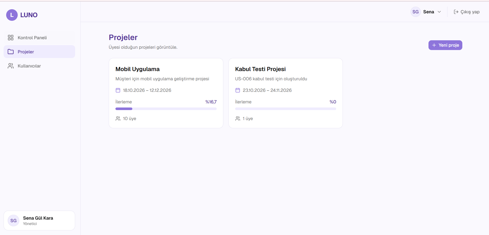
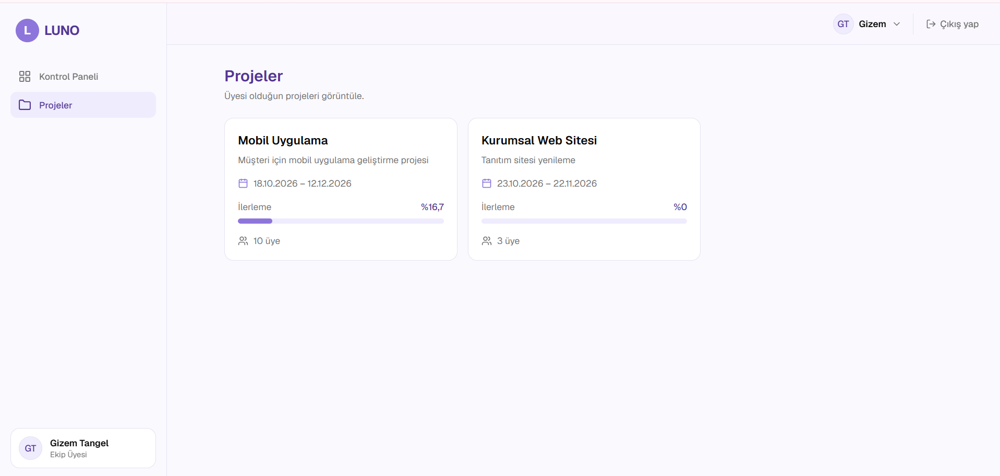
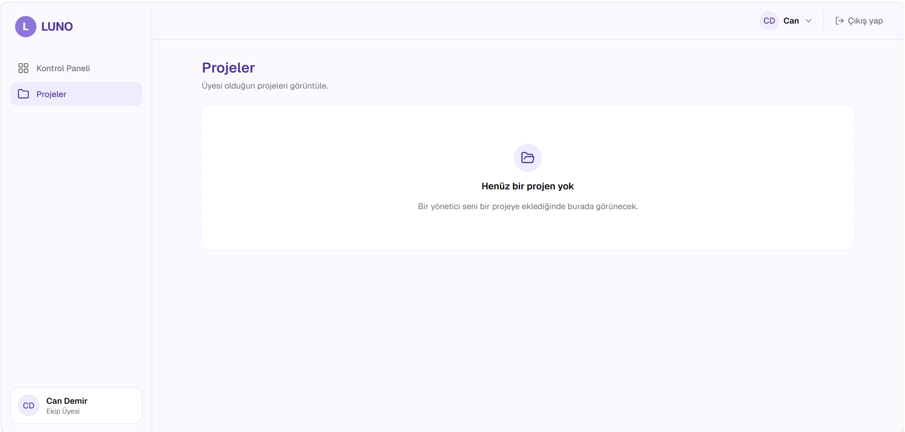

# US-007 Proje listeleme kabul testi

**Issue:** #105 (parent: #17) · **Gereksinim:** FR-017
**Test eden:** Gizem Tangel · **Ortam:** develop, yerel kurulum

## Sonuçlar

| # | Kabul kriteri | Hesap | Beklenen | Gerçekleşen | Sonuç |
|---|---|---|---|---|---|
| 1 | FR-017 | Sena (YONETICI) | Yalnızca üyesi olduğu projeler listelenir | Mobil Uygulama ve Kabul Testi Projesi görüldü, Kurumsal Web Sitesi görünmedi | Geçti |
| 2 | FR-017 | Gizem (EKIP_UYESI) | Yalnızca üyesi olduğu projeler listelenir | Mobil Uygulama ve Kurumsal Web Sitesi görüldü, Kabul Testi Projesi görünmedi | Geçti |
| 3 | FR-017 | Can (EKIP_UYESI, hiçbir projede üye değil) | Hiç proje listelenmez | Boş durum mesajı gösterildi | Geçti |

## Notlar

- Üyesi olunmayan projeler hiçbir hesapta listeye sızmadı.
- Boş durum mesajı: "Henüz bir proje yok. Bir yönetici seni bir projeye eklediğinde burada görünecek."
- "Yeni proje" butonu yalnızca yönetici hesabında görünüyor.

## Kanıtlar

