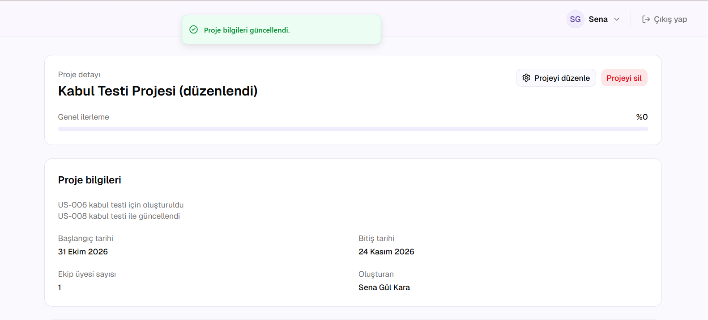
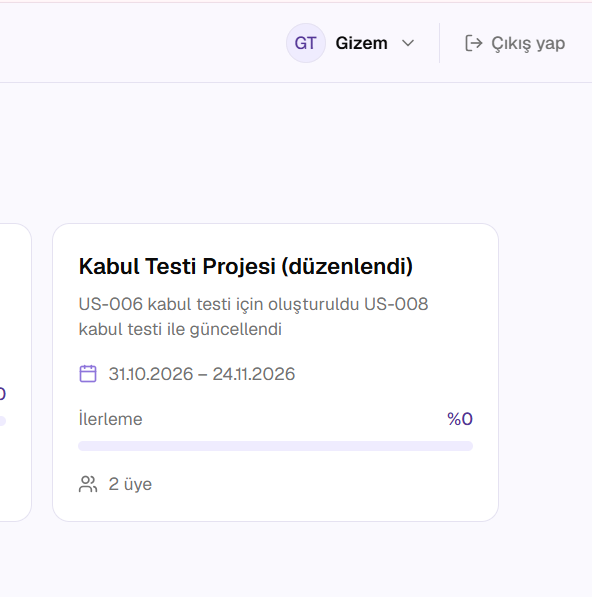

# US-008 Proje düzenleme kabul testi

**Issue:** #108 (parent: #18) · **Gereksinim:** FR-018
**Test eden:** Gizem Tangel · **Ortam:** develop, yerel kurulum
**Hesap:** Sena Gül Kara (YONETICI)

## Sonuçlar

| # | Kabul kriteri | Senaryo | Beklenen | Gerçekleşen | Sonuç |
|---|---|---|---|---|---|
| 1 | FR-018 | Projenin adı, açıklaması ve tarihleri düzenlenip kaydedildi | Bilgiler güncellenir | "Proje bilgileri güncellendi." mesajı çıktı, detay sayfasında yeni ad, açıklama ve tarihler görüldü | Geçti |
| 2 | FR-018 | Güncel bilgilerin kalıcılığı (Gizem hesabıyla liste) | Değişiklikler kalıcıdır | Listede yeni ad, açıklama ve tarihler görüldü | Geçti |

## Notlar

- Açıklama, eski metnin sonuna ekleme yapılarak güncellendi.
- Düzenleme, proje detay sayfasındaki "Projeyi düzenle" butonuyla yapılıyor.

## Kanıtlar

