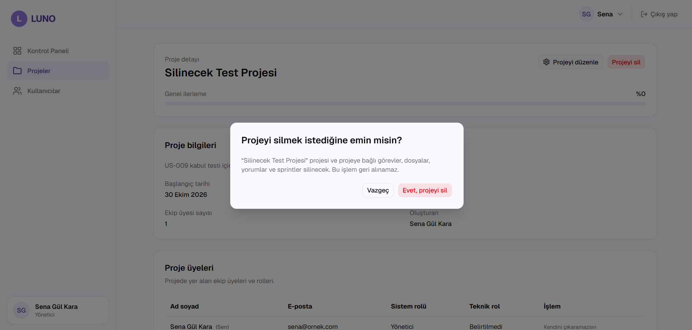
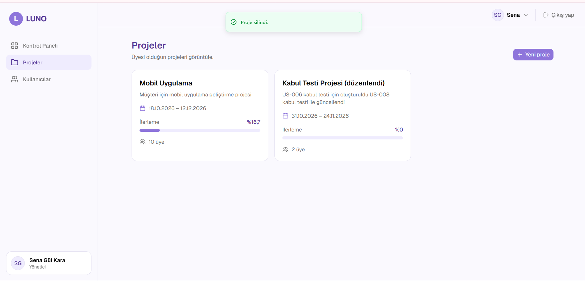

# US-009 Proje silme kabul testi

**Issue:** #111 (parent: #19) · **Gereksinimler:** FR-019, FR-020
**Test eden:** Gizem Tangel · **Ortam:** develop, yerel kurulum
**Hesap:** Sena Gül Kara (YONETICI)

## Sonuçlar

| # | Kabul kriteri | Senaryo | Beklenen | Gerçekleşen | Sonuç |
|---|---|---|---|---|---|
| 1 | FR-019 | "Silinecek Test Projesi" detayında "Projeyi sil" butonuna basıldı | Silmeden önce onay penceresi gösterilir | "Projeyi silmek istediğine emin misin?" penceresi açıldı, proje henüz silinmedi | Geçti |
| 2 | FR-020 | Onay penceresinde "Evet, projeyi sil" seçildi | Proje silinir | "Proje silindi." mesajı çıktı, proje listeden kalktı | Geçti |
| 3 | FR-020 | Projeye bağlı görevlerin silinmesi | Bağlı görevler de silinir | Test projesinde görev olmadığından arayüzden gözlemlenemedi, API otomatik testlerinde kapsanıyor | Gözlemlenemedi |

## Notlar

- Onay penceresi metni: projenin ve bağlı görevlerin, dosyaların, yorumların ve sprintlerin silineceğini, işlemin geri alınamayacağını belirtiyor.
- Silme testi için ayrı bir deneme projesi oluşturuldu, seed projelerine dokunulmadı.

## Kanıtlar

