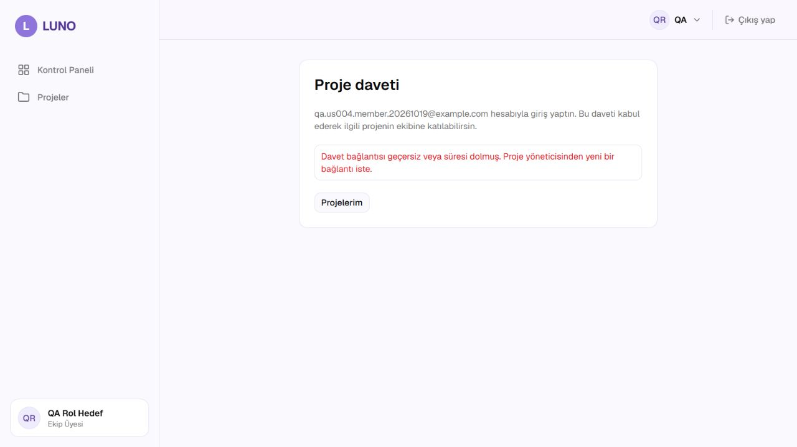
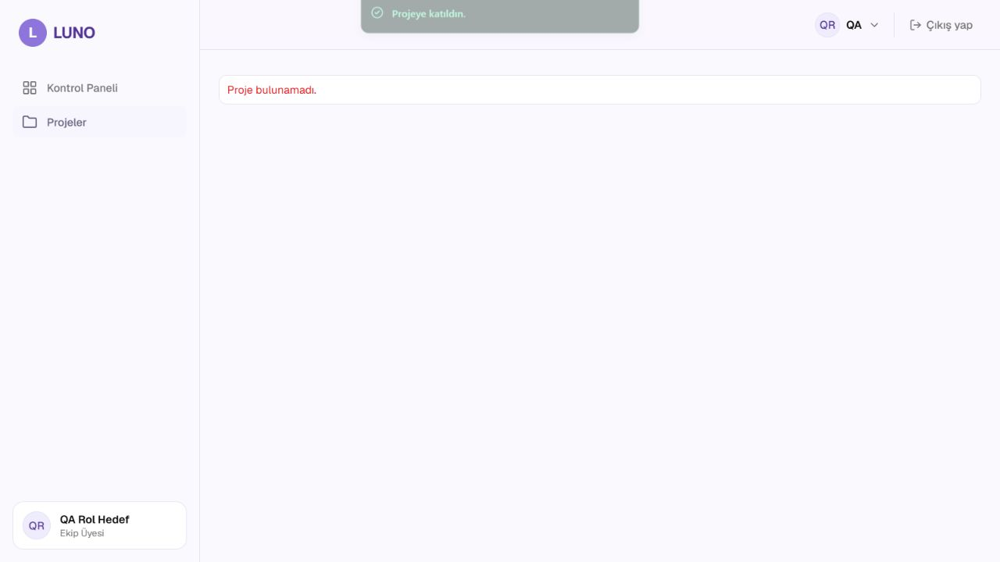
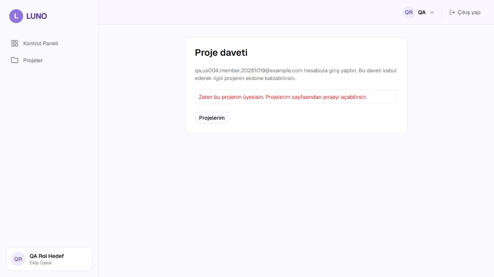

# US-010 Proje üyesi yönetimi testleri

Görev [#115](https://github.com/sengka/LUNO/issues/115) · Story [#20](https://github.com/sengka/LUNO/issues/20) · FR-021, FR-022.
19.10.2026 · Hakan Aydın, Codex ile API/tarayıcı otomasyonu · Temel develop **9fad8ab**.
Kaynak: [kabul kriterleri](../analiz/user-stories.md), [API sözleşmesi 5.6–5.10](../api/api-sozlesmesi.md).

## Sonuç

**Davet akışı doğrulandı; US-010 tam kabulü engelli.** Yeni dosya: **9 geçti, 12 Engelli/skip**. Tam backend: **84 geçti, 12 skip, 4 mevcut deprecation uyarısı**. Önceki QA dalları henüz develop'a birleşmediğinden sonuç 75 temel + 9 yeni testtir; önceki dalın 93 testiyle tek sürüm karşılaştırması yapılmaz.

E-posta ile üye ekleme/listeleme/çıkarma API'leri henüz bağlı değil ([açık #112](https://github.com/sengka/LUNO/issues/112), mevcut [#140](https://github.com/sengka/LUNO/issues/140)). Onaylı çıkarma, iptal, görevlerin atamasız kalması ve çıkarılan üyenin erişememesi uçtan uca geçti sayılamaz. Story'nin kapalı olması ürünün bu sürümde tüm kriterleri sağladığı anlamına gelmez.

## Ortam ve veri

Windows; Python 3.14.5 / pytest 9.1.1; Node 25.7.0; Chromium iç tarayıcısı. Canlı backend localhost:8000, frontend localhost:5173, SQLite. Otomatik testler conftest ile her testte izole bellek içi SQLite kullanır; gerçek API rotalarında TestClient çalışır, üyelik/yetki bağımlılıkları mock edilmez. PostgreSQL API entegrasyonu doğrulanmış sayılmaz.

Otomatik kurulum: iki proje A/B, üye yönetici, proje üyesi, yeni kullanıcı ve dışarıdaki yönetici. Test tokenları test anahtarıyla oluşturulur; bu dosya login/parola testi değildir. Saat sınırında yalnız davet modülünün saati sabitlenir; JWT saati değiştirilmez. Üye çıkarma testinde iki projede aynı kişiye atanmış görev kurulur; yalnız hedef projenin görevinin atamasız kalması beklenir.

Tarayıcıda önceki sentetik `QA Rol Hedef` / EKIP_UYESI hesabı kullanıldı. Yalnız `QA-US010-Valid-20261019` ve `QA-US010-Expired-20261019` projeleri ile iki davet SQL üzerinden test başlangıç verisi olarak eklendi (id 1/2). Bu kurulum yönetici oluşturma/e-posta ekleme/davet oluşturma API'sinin çalıştığına kanıt değildir. Test kullanıcıya admin rolü verilmedi. Gerçek ekip verisi değiştirilmedi. Tur sonunda yalnız bu geçici iki proje, davetleri ve test üyeliği temizlendi; QA hesabının rolü aynı kaldı. Seed reset çalıştırılmadı.

## Tekrar çalıştırma

Depo kökünden:

```powershell
.\backend\.venv\Scripts\python.exe -m pytest backend/tests/test_project_membership.py -q -r s
.\backend\.venv\Scripts\python.exe -m pytest backend/tests -q -r s
```

Bu Windows oturumunda tam tur ayrılmış yazılabilir `--basetemp` çalışma diziniyle çalıştırıldı. Pytest bu dizini temizleyebilir; yalnız disposable test dizini seçilir. 4 uyarı mevcut Starlette/httpx ve HTTP_422 deprecation uyarılarıdır. Kaynak ürün kodu değiştirilmedi.

## Yeni otomatik davet senaryoları

[Test kaynağı](../../backend/tests/test_project_membership.py).

| ID | Ön koşul / adımlar | Beklenen | Sonuç |
| --- | --- | --- | --- |
| INV01–03 | Sabit zamanda expiry -1 saniye, tam şimdi, +1 saniye; yeni kullanıcı daveti kabul eder | -1 ve 0: 400 INVITE_INVALID ve hiçbir veri değişmez; +1: 200 ve tek üyelik | 3 Geçti |
| INV04–05 | Geçerli davetle eksik/bozuk Authorization; sonra doğru kimlik | 401, üyelik/davet tüketimi yok; aynı davet sonra 200 | 2 Geçti |
| INV06 | Davetin projesini test DB'sinde sil; eski daveti kabul et | 400 INVITE_INVALID, yeni üyelik/veri değişimi yok | Geçti |
| INV07 | A davetine gövdede B project_id, başka user_id, YONETICI rolü ekleyerek katıl | Yalnız oturum sahibi A'ya katılır; B/başkası/rol etkilenmez | Geçti |
| INV08 | Proje sahibi olmayan fakat proje üyesi yönetici davet oluştursun | 201, davet oluşturan doğru yönetici | Geçti |
| INV09 | Daveti kabul et ve aynı kullanıcıyla yeniden dene | 200 sonra 409 ALREADY_MEMBER; tek üyelik, rol/veri aynı | Geçti |

Mevcut [test_invites.py](../../backend/tests/test_invites.py) içindeki 14 regresyon da tam turda geçti: yönetici davet oluşturma, benzersiz URL/7 gün, üyenin/dışarıdaki yöneticinin reddi, olmayan proje, anonim erişim, başarılı katılım ve proje yanıtı, çoklu kullanıcı, zaten üye/tekrar, geçersiz/süresi dolmuş davet ve proje silme cascade. Bu 14 test yeni eklenmiş gibi sayılmadı.

## Gerçek üyelik API'sine bağlı kabul senaryoları

Her koşullu skip yalnız ilgili **gerçek HTTP metodunun OpenAPI'de olmamasına** bağlı. Uç eklendiğinde otomatik etkinleşir; 404 başarı olarak sabitlenmedi, sahte üyelik API'si eklenmedi.

| ID / test case | Adımlar ve beklenen | Durum |
| --- | --- | --- |
| MEM01 list | Proje üyesi üye listesini açar; 200 ve doğru üyeler | Engelli: GET members yok |
| MEM02 email_add | Yönetici kayıtlı e-postayı teknik rolle ekler; 201 ve üyelik; tekrar 409, çift kayıt yok | Engelli: POST members yok |
| MEM03 unknown_email | Kayıtsız e-posta; 404 USER_NOT_FOUND ve veri aynı | Engelli |
| MEM04 invalid_email | Geçersiz e-posta; 422 VALIDATION_ERROR, veri aynı | Engelli |
| MEM05 remove | Yönetici üyeyi çıkarır; 204; hedef proje üyeliği silinir ve görevi atamasız; diğer proje/ataması kalır | Engelli: DELETE member yok |
| MEM06 self_remove | Yönetici kendini çıkarmayı dener; 400 CANNOT_REMOVE_SELF, veri aynı | Engelli |
| MEM07 unknown_member | Projede olmayan kullanıcıyı çıkarma; 404 MEMBER_NOT_FOUND, veri aynı | Engelli |
| MEM08–09 member_add/member_remove | Üye yönetici işlemlerini dener; 403 FORBIDDEN, veri aynı | 2 Engelli |
| MEM10 outsider_admin | Proje üyesi olmayan yönetici kullanıcı ekler; 403 PROJECT_ACCESS_DENIED | Engelli |
| MEM11 removed_access | Gerçek DELETE sonrası eski üye tokenıyla GET proje; 403 PROJECT_ACCESS_DENIED; diğer projede üyelik kalır | Engelli: DELETE ve GET proje yok |
| MEM12 anonymous | Oturumsuz e-posta ekleme; 401 UNAUTHORIZED ve veri aynı | Engelli |

## Tarayıcı / canlı veri kanıtı

| ID | Adımlar | Beklenen / gözlenen | Karar |
| --- | --- | --- | --- |
| UI01 | Olmayan davet adresini aç, Daveti kabul et | Geçersiz/süresi dolmuş mesajı; kabul düğmesi kalkar, üyelik yok | Geçti |
| UI02 | DB'de süresi geçmiş daveti aç, kabul et | Aynı mesaj ve üyelik yok | Geçti |
| UI03 | Geçerli daveti aç, kabul et | Projeye katıldın bildirimi ve /projeler/1 yönlendirmesi; DB'de tek (1,4) üyeliği | Katılım Geçti; devam ekranı #140 nedeniyle Engelli |
| UI04 | Aynı geçerli daveti yeniden aç/kabul et | Zaten bu projenin üyesisin mesajı; DB'de hâlâ tek üyelik | Geçti |
| UI05 | Yönetici proje üyeleri panelinden e-postayla ekleme ve çıkarma | Üye listesi/ekle/çıkar paneline erişilip işlem/onay test edilir | Engelli: proje detay API'si yok, panel gerçek veriyle açılamıyor |
| UI06 | Çıkarma onay penceresinde iptal; sonra onay; çıkarılan hesapla doğrudan URL | İptalde DELETE yok/veri aynı; onayda çıkarma/atamasız görev; eski hesap erişimi reddedilir | Engelli: panel ve üyelik API'leri yok |

UI05–06 için komponent kaynak incelemesi yapıldı (window.confirm ve iptal kontrolü var); **çalıştırılmış tarayıcı testi sayılmadı**. Post-removal yetki bağımlılığını tek başına çağırmak gerçek çıkarma kabulünün yerine kullanılmadı.

[Canlı API ve veri temizliği kanıtı](us-010-canli-kanit.json): geçersiz/süresi dolmuş/tekrar davet için 400/400/409; GET/POST/DELETE üyelik ve GET proje için 404; üyelik aynı. Canlı aktör üye olduğundan bu 404'ler yöneticinin e-posta ekleme davranışına kanıt değildir; doğru yönetici senaryoları MEM testlerinde hazırdır.






## Eksik kontrolü, takip ve kapanış

- FR-021'in davet yolu; sınır, hata/tekrar ve rol/proje bütünlüğü doğrulandı. E-posta yolu açık #112'yi bekliyor.
- FR-022'nin gerçek çıkarma, onay/iptal, atamasız görev ve eski tokenla erişim kontrolleri açıkça Engelli bırakıldı.
- Yeni bağımsız ürün hatası bulunmadı. Katılım sonrası 404 ve eksik üyelik uçları mevcut #140 / #112 ile takip edilir; aynı kök neden için kopya hata açılmadı. #140'a US-010'un katılım sonrası etkisi eklenir.
- Düzeltmeler birleşince 12 MEM testi, UI05–06 ve UI03 devam ekranı yeniden çalıştırılır; UI iptal/onay ayrı kanıtlanır. Anonim davetin giriş/kayıt sonrası aynı adrese dönüşü de o turda tarayıcıda tamamlanır; bu turda auth gerekliliği API'de doğrulandı.
- #115 kartı In progress kalır. Yalnız süresi dolmuş/geçersiz davet maddesi tamamdır. İlk ve üçüncü madde ile PR onayı, kabul engelleri ve ekip onayı bitene kadar işaretlenmez. Test kodu çalışıyor kutusu tüm story geçti anlamına gelmez.
